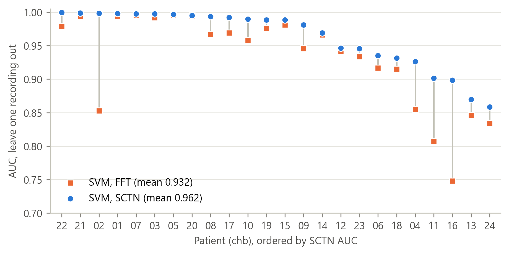
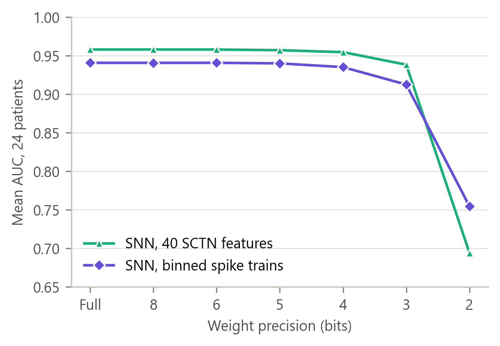
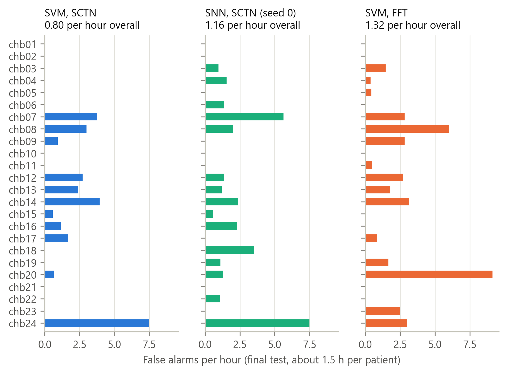
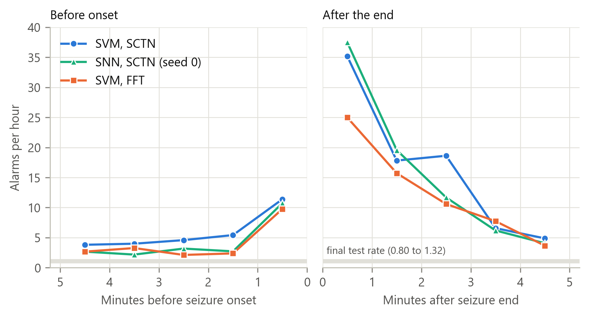

# Results (draft)

Draft of 21 November 2026. Every number is taken from the files in `analysis/stats/` at commit `aced3bc` of branch `snn-classifier`. The figures are made by `thesis/figures/make_figures.py`. The source file for each table is given under it.

## 1. Data and evaluation

The evaluation uses all 24 patients of the CHB-MIT scalp EEG database. Ten bipolar channels are used. Of the recordings that contain seizures, 138 could be encoded with this channel set, and they hold 185 seizures. Three recordings of patient chb12 use a different montage and were left out.

Each channel is filtered to 0.5 to 62 Hz and passed through a bank of 28 SCTN resonators that cover the Delta, Theta, Alpha and Beta bands. The input is scaled to a fixed full scale of 100 µV and clipped. The signal is cut into windows of 2 s with 50% overlap. For each window, the feature of a resonator is the standard deviation of its spike count in 10 ms bins. Averaging over the resonators of a band gives 40 features per window (10 channels by 4 bands). Keeping every resonator gives 280 features.

The baseline is the FFT band power of the same windows in the same four bands, which also gives 40 features.

Seizure minutes and an equal number of randomly chosen minutes at least 5 minutes away from any seizure form the main dataset. The 5 minutes on each side of a seizure are a guard band and are not used.

Models are trained per patient. Window classification is scored by leave one recording out: every recording is held out once, and the area under the ROC curve (AUC) is computed over the pooled held-out windows of the patient. Differences between methods are tested with the Wilcoxon signed-rank test over the 24 patients.

## 2. Window classification

| Features | Classifier | Mean AUC |
|---|---|---|
| SCTN, 40 features | SVM | 0.962 |
| SCTN, 280 features | SVM | 0.967 |
| SCTN, 40 features | SNN (mean of 3 seeds) | 0.957 |
| SCTN, binned spike trains | SNN (mean of 3 seeds) | 0.943 |
| FFT band power | SVM | 0.932 |
| FFT band power, input clipped at 100 µV | SVM | 0.949 |

Source: `fft_vs_sctn_summary_fs100.json`, `svm_feature_sets.csv`, `scale_robustness_200uv.csv`, `output_data/results/snn_classifier_report_fs100_*.csv`.

Figure 1. AUC per patient with the SVM, for SCTN features and FFT band power. Patients are ordered by the SCTN AUC.

With the SVM, the SCTN features give a higher AUC than FFT band power for every one of the 24 patients (p < 0.0001). The median gain is 0.018.

Part of this gain comes from the input clipping and not from the resonators. When the FFT is computed on a signal clipped at the same 100 µV, its AUC rises from 0.932 to 0.949. The remaining gap to SCTN is 0.014. SCTN is still higher for 20 of 24 patients (p = 0.001), but the median gain is only 0.003.

The result does not depend on the exact full scale. At 200 µV the SCTN features give 0.953 and the clipped FFT gives 0.940. SCTN is higher for 20 of 24 patients (p = 0.0006). The 100 µV setting is better than 200 µV by about 0.01 (p = 0.014).

Using all 280 resonator features instead of 40 does not give a significant gain (0.967 against 0.962, p = 0.34). Adding the Gamma band does not help either: 50 features with Gamma give 0.962, the same as 40 without it (p = 0.90). The Gamma band alone gives 0.920. The 40-feature set is therefore used in the rest of the chapter.

An earlier stage of this work found the FFT slightly ahead. That result came from scaling every minute to its own peak in the encoder, which removed the amplitude difference between seizure and background. It is superseded by the fixed scale.

## 3. The SNN classifier

The SNN has an encoding layer, a hidden layer of 64 leaky integrate-and-fire neurons and an output layer. It is trained with surrogate gradients.

On the 40 SCTN features the SNN reaches a mean AUC of 0.957 over three seeds, against 0.962 for the SVM. Fed directly with the binned spike trains of the resonators, with no hand-made feature, it reaches 0.943. For one patient (chb16) the spike-train model stays between 0.63 and 0.75.

### Weight precision

Neuromorphic hardware stores weights with few bits. The trained weights were rounded to N bits with no retraining (seed 0).

| Model | Full | 8 bits | 6 bits | 5 bits | 4 bits | 3 bits | 2 bits |
|---|---|---|---|---|---|---|---|
| SNN, 40 SCTN features | 0.958 | 0.958 | 0.958 | 0.957 | 0.955 | 0.938 | 0.694 |
| SNN, binned spike trains | 0.941 | 0.941 | 0.941 | 0.940 | 0.935 | 0.913 | 0.755 |

Source: `snn_quantization_features.csv`, `snn_quantization_bins.csv`.

Figure 2. Mean AUC of the two SNN models against the number of bits per weight (seed 0).

Both models keep their accuracy down to 5 bits. At 4 bits the mean loss is not significant, but one patient loses 0.11 with the spike-train model. At 3 bits the loss is significant (p = 0.003 and p = 0.0004). The leak and the threshold were not rounded.

## 4. Seizure detection on held-out data

### Protocol

The detector protocol was fixed on 17 November 2026, before the test data was scored. The test data was scored once.

- Training data of a patient: the seizure recordings, plus two minutes from each seizure-free recording as extra background.
- Decision: the default threshold of each model. An alarm is raised after 5 consecutive flagged windows.
- Sensitivity and delay: leave one recording out over the seizure recordings.
- False alarms: four new random minutes from each of the 545 seizure-free recordings, 36.3 hours in total.

### Results

| Model | Seizures detected | False alarms per hour | 95% interval | Median delay |
|---|---|---|---|---|
| SVM, SCTN | 175 of 185 (94.6%) | 0.80 | 0.34 to 1.38 | 6 s |
| SNN, SCTN, seed 0 | 178 of 185 (96.2%) | 1.16 | 0.65 to 1.76 | 7 s |
| SNN, SCTN, seed 1 | 179 of 185 (96.8%) | 2.04 | 0.95 to 3.39 | 7 s |
| SNN, SCTN, seed 2 | 178 of 185 (96.2%) | 0.96 | 0.48 to 1.58 | 7 s |
| SNN, binned spike trains | 171 of 185 (92.4%) | 1.07 | 0.42 to 2.04 | 8 s |
| SVM, FFT | 173 of 185 (93.5%) | 1.32 | 0.63 to 2.30 | 7 s |

Intervals are from a bootstrap over patients. Source: `fa_ci_final.csv`, `detection_delay_k5.csv`.

Figure 3. False alarms per hour for each patient in the final test. Each patient has about 1.5 hours of test data, so a single alarm moves a bar by about 0.7 per hour.

All models detect between 92% and 97% of the seizures with a median delay of 6 to 8 seconds. The differences in false alarms between the models are not significant on 36 hours, with one exception: SNN seed 1 is worse than seeds 0 and 2. The SCTN detector has 0.52 fewer false alarms per hour than the FFT detector, but the 95% interval of this difference runs from −0.12 to +1.42.

One patient (chb16) has the largest share of missed seizures. The models miss 2 to 10 of its 10 seizures, and with the SVM it accounts for 5 of the 10 misses. False alarms are concentrated in a few patients.

### False alarms near seizures

The guard band is excluded from the test above. To see how the detector behaves there, the 5 minutes on each side of every seizure were encoded separately (30.2 hours) and scored by leave one recording out with the same frozen detector.

| EEG scored | Hours | SVM, SCTN | SNN, SCTN (seed 0) | SVM, FFT |
|---|---|---|---|---|
| Final test, seizure-free recordings | 36.3 | 0.80 | 1.16 | 1.32 |
| Seizure-free recordings not seen in training | 18.2 | 1.21 | 1.98 | 2.64 |
| Seizure recordings, at least 5 min from a seizure | 5.9 | 3.05 | 4.75 | 4.41 |
| 1 to 5 min before onset | 12.4 | 4.45 | 2.67 | 2.43 |
| Last minute before onset | 3.1 | 11.4 | 10.7 | 9.8 |
| First minute after the end | 3.0 | 35.2 | 37.5 | 25.0 |
| 1 to 5 min after the end | 11.7 | 11.6 | 10.2 | 9.2 |

Values are false alarms per hour. Source: `fa_context_ci_k5.csv`.

Figure 4. Alarms per hour in one-minute steps before seizure onset and after seizure end. The grey band is the range of the final test rates.

Three observations follow.

First, all detectors keep alarming after a seizure ends. With the SVM, 67 of 185 seizures have an alarm in the minute after the annotated end, and the rate stays raised for about 3 minutes. Both SCTN models alarm more than the FFT model in that first minute.

Second, before onset only the last minute is raised (27 of 185 seizures). Many of these alarms are early detections of a seizure whose annotated onset is slightly late.

Third, the false alarm rate of the final test is an interictal rate. It also benefits from two minutes of each test recording being in the training data. On seizure-free recordings that the model never saw, the rate is 1.5 to 2 times higher. This difference is not significant for any single model. The higher rate in seizure recordings away from seizures rests on 5.9 hours and is not significant once the patient mix is matched (p = 0.51 for the SVM).

## 5. Generalisation across patients

When a model is trained on 23 patients and tested on the one left out, the mean AUC is 0.832 for the SVM on SCTN features, 0.828 for the SNN and 0.821 for the FFT baseline. One patient (chb14) fails for all models. The detectors in this work are therefore patient-specific.

Source: `cross_patient_*.csv`.

## 6. Computational cost

For one second of 10-channel EEG the SCTN front-end performs about 8.4e7 neuron updates. The FFT features need about 8.7e4 multiplications. By operation count the SCTN front-end is about 960 times more expensive.

The case for SCTN is therefore architectural and not a lower operation count. The resonators need no multipliers and are event-driven, which suits neuromorphic hardware, and the classifier works with 5-bit weights. Whether this gives a power saving is a hypothesis. Measuring it on a neuromorphic processor is future work.

## 7. Limitations

- SCTN is ahead of FFT with the SVM. With a random forest the two feature sets are tied (0.963 against 0.959, 14 of 24 patients, p = 0.29). The advantage therefore depends on the classifier.
- The 100 µV full scale and the SNN settings were chosen on the same recordings that give the AUC values. The 200 µV result reduces this concern for the scale only.
- The burstiness feature is computed from the spike trains outside the spiking domain. Only the binned spike-train SNN works without it.
- The false alarm estimate rests on 36.3 hours and has a wide interval. It is measured on sampled minutes and not on continuous recordings.
- The periods around seizures are excluded from the false alarm rate.
- The models are patient-specific.
- The SNN results near seizures and under weight rounding use one seed. The spike-train SNN has one seed in the final test.
- All results come from one dataset.
